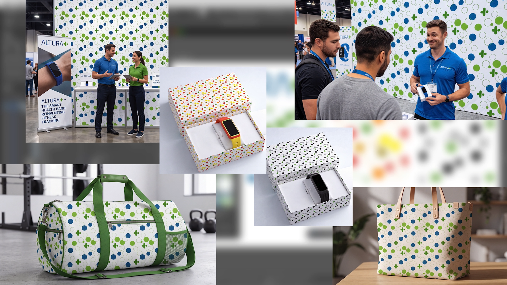
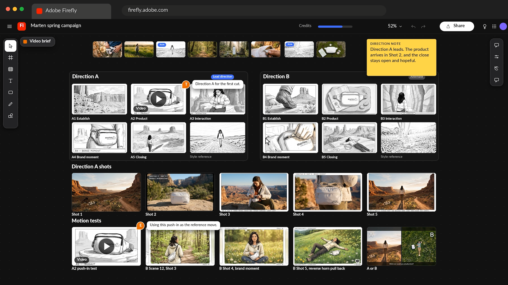
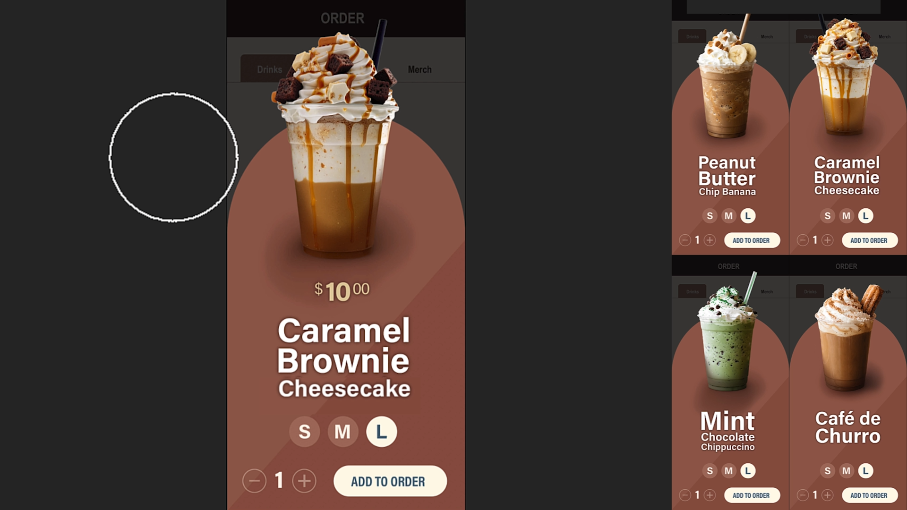

# Tutoriels Creative Cloud abonnement Entreprise AI

Explorez les tutoriels qui peuvent vous aider à découvrir des idées, à créer du contenu et à rationaliser les workflows créatifs à l’aide de l’IA dans le Creative Cloud. Ces tutoriels sont regroupés par rôle : Designer graphique, Creative/Art Director, Photoshop Artist/Retoucher et Éditeur vidéo.

## Designer graphique

<table style="table-layout:fixed">
<tr>
 <td>
   
    

   <a href="turn-flat-vector-art.md"><strong>Convertissez les illustrations vectorielles plates selon n’importe quel angle, sans les redessiner</strong></a>
    

    <em>Découvrez comment utiliser la fonctionnalité Texte en motif dans Illustrator</em>
     
  </td>
  <td>
   
    

   <a href="seamless-vector.md"><strong>Des motifs vectoriels transparents en quelques minutes, et non en quelques heures</strong></a>
    

    <em>Apprenez à créer un modèle de marque transparent dans Illustrator sans vérifier manuellement chaque bord de répétition</em>
     
  </td>
  <td>
    
    

     
  </td>
  <td>
    
    

     
  </td>
</tr>
</table>

## Director créative/artistique

<table style="table-layout:fixed">
<tr>
  <td>
   
    

   <a href="one-brief.md"><strong>20 itinéraires à partir d'une brève, avant le déjeuner</strong></a>
    

    <em>Apprenez à transformer une présentation créative en un forum partagé de directions visuelles fortes</em>
     
  </td>
  <td>
    
    

     
  </td>
  <td>
    
    

     
  </td>
  <td>
    
    

     
  </td>
</tr>
</table>

## Artiste/Retoucheuse Photoshop

<table style="table-layout:fixed">
<tr>
  <td>
   
    

   <a href="retouch-faster.md"><strong>Retouche plus rapide et conservation des pixels d’origine</strong></a>
    

    <em>Découvrez comment ajouter des ombres naturelles à une photo de produit dans Photoshop tout en conservant vos pixels d'origine intacts</em>
     
  </td>
  <td>
    
    

     
  </td>
  <td>
    
    

     
  </td>
  <td>
    
    

     
  </td>
</tr>
</table>

